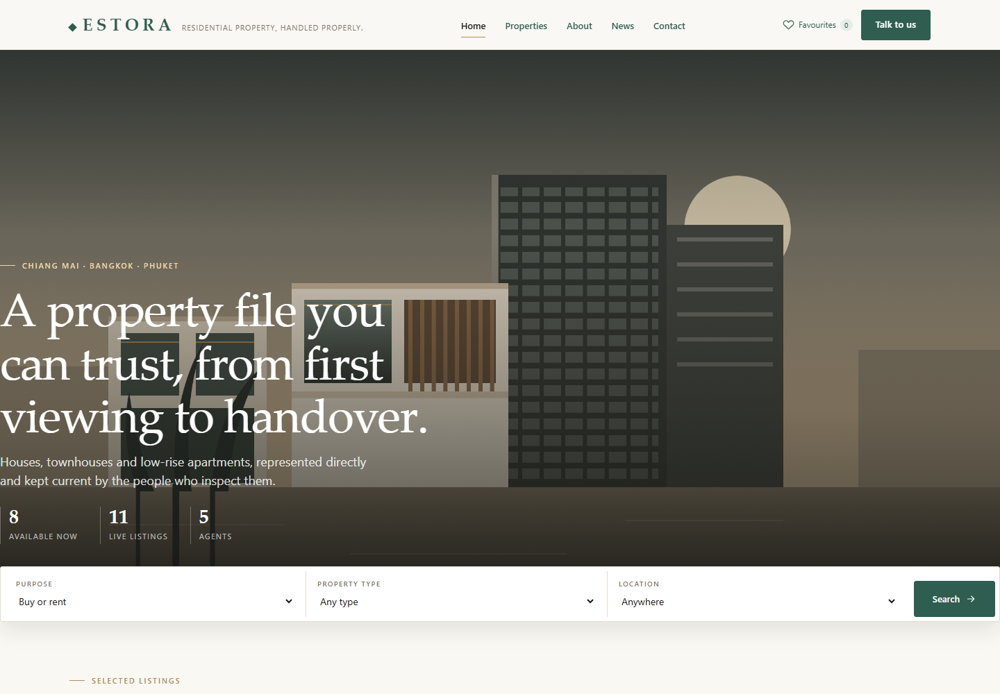
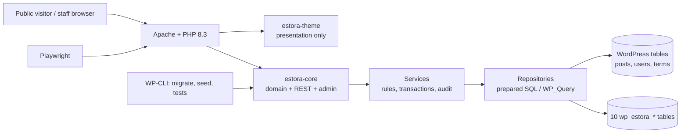

# ESTORA

**Real estate management platform** — a public property website and a complete back office
(inventory, CRM, viewings, reporting) built as a custom WordPress theme and business plugin.



## The problem

A brokerage usually runs its website on WordPress and its pipeline in spreadsheets. The website
cannot see the pipeline; inquiries rot in an inbox; viewings double-book agents; nobody can say
which channel produced a sale. ESTORA closes the loop inside one system: the same database row
that powers a public listing also powers the CRM stage, the viewing, the notification and the
report.

## What is implemented

| Area | Delivered |
| --- | --- |
| Public site | Home, property archive with server-side filters/sort/pagination, property detail with gallery, inquiry and viewing forms, favorites, 3-way comparison, about, contact, news, privacy, terms, 404, campaign-ready landing template |
| Inventory | `property` CPT, 3 taxonomies, 25+ validated fields, gallery, publication and availability state machines, duplicate, publish guard, admin inventory table, REST CRUD |
| CRM | Lead capture from inquiries, appointments, manual entry and API; dedupe; assignment history; notes; pipeline with enforced transitions; follow-ups; agent scoping; kanban; analytics from SQL |
| Scheduling | 45-minute slot grid in business hours, lunch exclusion, past-date guard, agent and property conflict checks, reschedule, unique active-slot index, month/week/day calendar |
| Back office | Dedicated `/estora-admin/` application (not wp-admin): role-aware dashboard with real KPIs and charts, lead table + drawer + board, appointment calendar and staff booking, inventory, agents, locations, campaigns, content, reports, notifications, audit, users and settings |
| RBAC | 6 roles, 17 capabilities, ownership checks; UI hiding is never the control |
| API | `/wp-json/estora/v1` — properties, leads, appointments, agents, dashboard, favorites, inquiries, notifications, campaigns, settings, audit, config, health |
| Notifications | In-app rows with read state and dedupe; `wp_mail` with honest failure logging |
| SEO | Unique meta/OG, canonical, `RealEstateListing` JSON-LD, core sitemap integration, campaign UTM attribution |
| Ops | Docker Compose (WordPress, MySQL 8, WP-CLI, phpMyAdmin), migrations, idempotent seed, backup/restore, CI, screenshots |

Screens: [home](docs/screenshots/home.png) · [properties](docs/screenshots/properties.png) ·
[detail](docs/screenshots/property-detail.png) · [compare](docs/screenshots/compare.png) ·
[login](docs/screenshots/login.png) · [dashboard](docs/screenshots/app-overview.png) ·
[kanban](docs/screenshots/app-kanban.png) · [calendar](docs/screenshots/app-appointments.png) ·
[reports](docs/screenshots/app-reports.png) · [mobile](docs/screenshots/app-mobile-dashboard.png) ·
[all screenshots](docs/screenshots)

## Stack

**Backend:** PHP 8.3 · WordPress 6.7 · MySQL 8.0 · Composer  
**Frontend:** HTML5 · CSS3 (custom design system + Bootstrap 5) · vanilla ES2020 · Fetch API  
**Testing:** PHPUnit 10 · WordPress-bootstrapped integration · Node test runner (HTTP) · Playwright  
**Ops:** Docker Compose · WP-CLI · GitHub Actions

## Architecture



- Business data lives in the plugin; switching themes does not remove or break it.
- The theme never writes business tables. It renders and talks to the same REST endpoints as
  external integrations.
- Read the decisions in [docs/TECHNICAL_DECISIONS.md](docs/TECHNICAL_DECISIONS.md) and the ER model
  in [docs/ER_DIAGRAM.md](docs/ER_DIAGRAM.md).

## Quick start

Prerequisites: Docker Desktop (Compose v2). Node 20+ only for tests/screenshots.
Ports 8080 (site), 8081 (phpMyAdmin), 3307 (MySQL) must be free.

```bash
git clone <repo> estora && cd estora
cp .env.example .env
docker compose up -d db wordpress
bash scripts/bootstrap.sh        # Windows: powershell -ExecutionPolicy Bypass -File scripts/bootstrap.ps1
```

Open <http://localhost:8080>. Staff sign in at `/wp-login.php` and land in the ESTORA back office
at **`/estora-admin/`**; `/wp-admin/` remains the technical WordPress administration area for Super
Admins. The bootstrap is idempotent: it installs WordPress when absent, enables the theme and plugin,
runs migrations, flushes permalinks and seeds demo content.

Install PHP tooling once for tests:

```bash
docker run --rm -v "$PWD":/app -w /app composer:2 install --no-interaction --no-audit
```

### Demo accounts (development only)

| Role | Email | Password |
| --- | --- | --- |
| Super Admin | `admin@estora.test` | `WP_ADMIN_PASSWORD` in `.env` |
| Administrator | `operations@estora.test` | `ESTORA_TEST_AGENT_PASSWORD` |
| Sales manager | `manager@estora.test` | `ESTORA_TEST_AGENT_PASSWORD` |
| Sales agent | `agent@estora.test` | `ESTORA_TEST_AGENT_PASSWORD` |
| Sales agent | `mai@estora.test` | `ESTORA_TEST_AGENT_PASSWORD` |
| Property manager | `property@estora.test` | `ESTORA_TEST_AGENT_PASSWORD` |
| Marketing | `marketing@estora.test` | `ESTORA_TEST_AGENT_PASSWORD` |

Super Admin is the WordPress `administrator` role and keeps `/wp-admin/`; Administrator is the
ESTORA `estora_administrator` role with every business module and CMS/user access but no plugin,
theme or site-option menus. The seed refuses to run when `wp_get_environment_type()` is
`production`.

## Everyday commands

```bash
docker compose logs -f wordpress
docker compose run --rm cli wp estora status
docker compose run --rm cli wp estora migrate --yes
docker compose run --rm cli wp estora seed --force
bash scripts/backup.sh
bash scripts/restore.sh backups/<file>.sql.gz
```

## Testing

```bash
bash scripts/test.sh          # all gates
SKIP_E2E=1 bash scripts/test.sh

# Windows
powershell -ExecutionPolicy Bypass -File scripts/test.ps1
```

Individually:

```bash
bash scripts/lint.sh
docker compose run --rm -T --entrypoint php cli /opt/estora/vendor/bin/phpunit -c /opt/estora/phpunit.xml
docker compose run --rm -T cli wp eval-file /opt/estora/tests/wp/integration.php
node --test --test-concurrency=1 tests/http/
npx playwright test -c tests/e2e/playwright.config.js
```

Current results are recorded in [docs/TEST_REPORT.md](docs/TEST_REPORT.md): 37 unit tests,
12 WordPress integration groups, 24 HTTP tests and 16 browser journeys pass. HTTP suites run with
`--test-concurrency=1` because they share the seeded accounts and nonce state.

## API

Base `http://localhost:8080/wp-json/estora/v1`.

- Public: `GET /properties`, `/properties/{id}`, `/appointments/availability`, `/public/config`,
  `GET/POST /favorites`, `POST /inquiries`, `POST /appointments`, `GET /health`.
- Authenticated: leads, staff appointments, agents, dashboard, notifications, campaigns, settings,
  audit.
- Auth: WordPress cookie + `X-WP-Nonce` (admin JS), or Application Passwords (HTTP Basic) for
  integrations. Public writes also require the form nonce plus a honeypot and a per-contact rate
  limit.
- Full contract and examples: [docs/API_SPECIFICATION.md](docs/API_SPECIFICATION.md).

## Security

Capability checks and ownership predicates on every protected route, prepared statements, escaped
output, nonces, upload MIME/extension/size guards, rate limiting, login throttling, audit logging,
and no secrets in the repository. The detailed model and the executed checks are in
[docs/SECURITY_REQUIREMENTS.md](docs/SECURITY_REQUIREMENTS.md#8-xss--csrf--idor--sql-test-coverage)
and [docs/TEST_REPORT.md](docs/TEST_REPORT.md).

## Documentation

- [Project overview](docs/PROJECT_OVERVIEW.md)
- [Back-office experience (v1.1.0)](docs/ADMIN_EXPERIENCE.md)
- [Requirements](docs/REQUIREMENTS.md)
- [System architecture](docs/SYSTEM_ARCHITECTURE.md)
- [Database design](docs/DATABASE_DESIGN.md) · [ER diagram](docs/ER_DIAGRAM.md)
- [API specification](docs/API_SPECIFICATION.md)
- [Security requirements](docs/SECURITY_REQUIREMENTS.md)
- [UI/UX guidelines](docs/UI_UX_GUIDELINES.md)
- [Testing strategy](docs/TESTING_STRATEGY.md) · [Test report](docs/TEST_REPORT.md)
- [Deployment guide](docs/DEPLOYMENT_GUIDE.md)
- [Roadmap](docs/DEVELOPMENT_ROADMAP.md) · [Acceptance criteria](docs/ACCEPTANCE_CRITERIA.md)
- [Release notes](docs/RELEASE_NOTES.md)

## Limitations (honest)

- Photography is intentionally local: six architectural artboards, rasterised to PNG, are used for
  seeded listings and as fallbacks. Real listings should upload their own media; the upload path is
  implemented and tested.
- Email uses `wp_mail`; no SMTP provider is bundled. Failures are written to
  `wp-content/uploads/estora-mail.log` and surfaced, never hidden.
- One office, one currency (THB), no payments, SMS, MLS syndication or native apps.
- The CI workflow is committed but has not run on GitHub from this machine (no remote).

## License

GPL-2.0-or-later. See [LICENSE](LICENSE).
