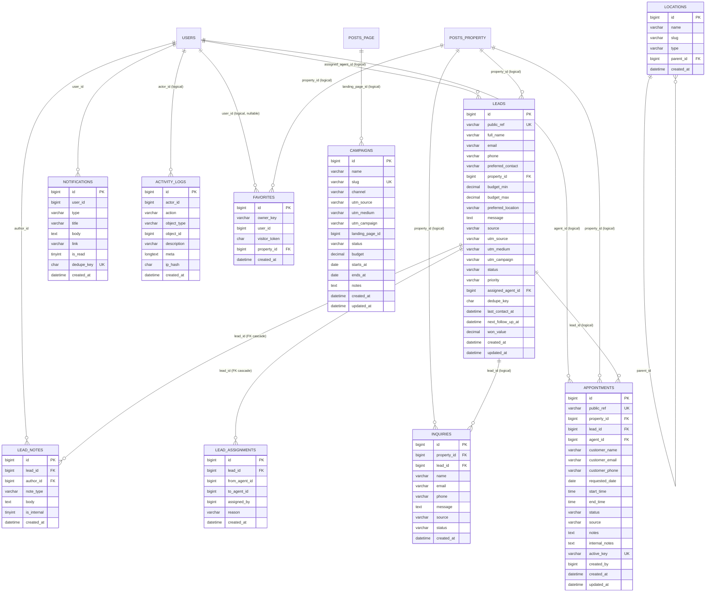

# ESTORA — ER Diagram

## Relationship notes

- `USERS`, `POSTS_PROPERTY` and `POSTS_PAGE` are WordPress core tables; arrows are **logical**
  references (no FK constraints) so core deletes/imports are never blocked. Services clean up.
- `LEAD_NOTES` and `LEAD_ASSIGNMENTS` are inside the plugin domain and use real FKs with
  `ON DELETE CASCADE`.
- `FAVORITES.owner_key` carries the uniqueness for both authenticated (`u:{id}`) and guest
  (`v:{token}`) owners because MySQL unique indexes treat `NULL` values as distinct.
- `APPOINTMENTS.active_key` is the concurrency guard for exact-slot double booking; range overlap
  is still checked in SQL.
- `LEADS.dedupe_key` is a lookup aid, not unique, because repeat interest is meaningful and is
  appended as notes rather than rejected.
